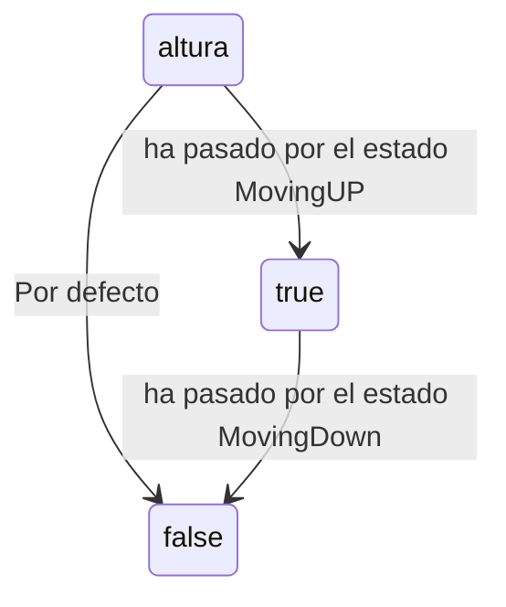

# Solucion.md

Para hacer este codigo me centre en querer hacer la base
y luego ir añadiendole complegidad poco a poco. Lo cual fue un error ya que 
esto provoco que empezara a liarme y perderme mutiples veces.

Esto provoco que no me diera tiempo a hacer el examen por completo,
pero lo peor fue que esto no me permitio hacer comprobaciones.

Por lo menos he aprendido que mejor una cosa pero bien a muchas pero poco

## Gestor

Con el archivo de gestor buscaba hacer que el idle reconociera si estaba arriba o abajo,
y esto lo consegui mediante la variabe altura que es un booleano.

Tambien hice que cuando estemos en Idle se printee la ubicacion del ascensor

## Botonera

Una simple declaracion de variables que lo que hace es declarar el piso 0 y el piso 1

## Estados

Se indica que hace cada Estado en el idle intente hacer que usara las variables de botonera tambien añadi
una funcion para evitar que el usuario pueda subir hasta el cielo o bajar al infierno si esto fuera a pasar 
saltamos al estado de error que vuelve al ide sin hacer nada

| Transición | Condición |
| --- | --- |
| Idle → UP | Se pulsa boton nivel 1|
| Idle → Down | Se pulsa boton 0|
| Idle →  ERROR | Se intenta bajar estando abajo o subir estando arriba|

